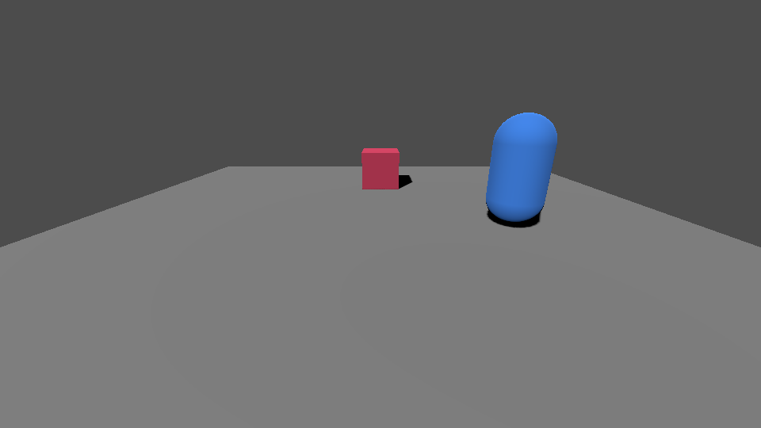
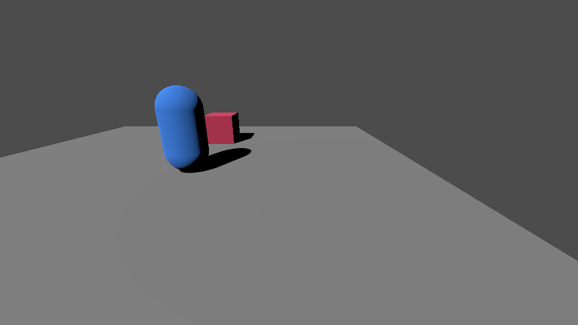

{/* Copyright Francesco Di Blasi 2026 - All Rights Reserved */}

Run two copies of your game in Godot. One player hosts the world and the other joins it. Both copies run on your computer and connect over the loopback address using Crimson's default ENet transport.

Start with the project from the solo guide. You need `res://world.tscn`, `res://player.tscn`, and a `Main` node in `res://main.tscn` with `res://main.gd` attached. Use the code configuration path for `Main`. If you added a `Game` child while trying the Inspector path, remove that child from `main.tscn` so the script can create it. [Start a solo game](/quickstart)

## Give each player a place to spawn

1. Open `world.tscn` from **FileSystem**. Select the original spawn point under `World` and press **Ctrl+D**. Rename the duplicate `GuestSpawn`.
2. Select `GuestSpawn` and set **Transform → Position** to `(2.5, 0, 0)` in the Inspector. Leave the original at `(0, 0, 0)` and save the scene.

Crimson gives each player an unoccupied [`PlayerSpawnPoint`](/api/classes/PlayerSpawnPoint). The two positions leave space between the players.

## Make the other player visible

1. Open `player.tscn`. Select the `Player` root and add a `MeshInstance3D` child named `Body`.
2. Select `Body`. In the Inspector, assign **New CapsuleMesh** to **Mesh** and set **Transform → Position** to `(0, 1, 0)`. You can give it a blue material to match the screenshots.
3. Select `Player` again and add a [`LocalPlayerView`](/api/classes/LocalPlayerView) child. Select it, then drag the `Camera3D` node from **Scene** to **Camera** in the Inspector. Drag `Body` to **Hidden Visuals**. Save `player.tscn`.

Crimson activates the camera and hides the body on your own player. The other player's capsule stays visible.

## Configure two players

Double-click `main.gd` in **FileSystem**. Replace its contents with this checkpoint. The scene references and world ID stay the same as in the solo guide. [`with_multiplayer()`](/api/classes/GameDefinition/methods/with_multiplayer) adds the player limit and UDP port to the definition before [`boot()`](/api/classes/GameDefinition/methods/boot) attaches `Game` to `Main`.

```gdscript
extends Node

const WORLD_ID: StringName = &"training_room"
const WORLD_SCENE: PackedScene = preload("res://world.tscn")
const PLAYER_SCENE: PackedScene = preload("res://player.tscn")
const TOTAL_PLAYERS: int = 2
const GAME_PORT: int = 7000

var game: GameRuntime


func _ready() -> void:
    var rules: MultiplayerRules = (
        MultiplayerRules.listen_coop()
        .with_max_players(TOTAL_PLAYERS)
        .allow_join_in_progress(true)
        .on_port(GAME_PORT)
    )
    var definition: GameDefinition = (
        GameRuntime.configure()
        .with_starting_world(WORLD_ID, WORLD_SCENE)
        .with_player(PLAYER_SCENE)
        .with_multiplayer(rules)
    )
    game = definition.boot(self)
    if game == null:
        push_error("Could not attach GameRuntime.")
        return

    print("Two-player game configured.")
```

Save the script, open `main.tscn`, and press **F6**. Look for `Two-player game configured.` in **Output**. An empty game view is expected at this step. The world loads when you host or join. Return to the editor and press **F8** before continuing.

Two seats means one host and one guest. [`allow_join_in_progress()`](/api/classes/MultiplayerRules/methods/allow_join_in_progress) lets the guest join after the host has entered the world. Both copies of the game use the same configuration and runtime node path.

## Start a session with H or J

Replace `main.gd` with this full script. It keeps the configuration from the previous step and adds two actions. **H** calls [`host_game()`](/api/classes/GameRuntime/methods/host_game) with `127.0.0.1` so only this computer can connect. **J** calls [`join_game()`](/api/classes/GameRuntime/methods/join_game) with the same address. Each action waits for Crimson to load the world and spawn the local player before printing its result.

```gdscript
extends Node

const WORLD_ID: StringName = &"training_room"
const WORLD_SCENE: PackedScene = preload("res://world.tscn")
const PLAYER_SCENE: PackedScene = preload("res://player.tscn")
const TOTAL_PLAYERS: int = 2
const GAME_PORT: int = 7000
const LOOPBACK_ADDRESS: String = "127.0.0.1"
const HOST_KEY: Key = KEY_H
const JOIN_KEY: Key = KEY_J

var game: GameRuntime
var _starting: bool = false


func _ready() -> void:
    var rules: MultiplayerRules = (
        MultiplayerRules.listen_coop()
        .with_max_players(TOTAL_PLAYERS)
        .allow_join_in_progress(true)
        .on_port(GAME_PORT)
    )
    var definition: GameDefinition = (
        GameRuntime.configure()
        .with_starting_world(WORLD_ID, WORLD_SCENE)
        .with_player(PLAYER_SCENE)
        .with_multiplayer(rules)
    )
    game = definition.boot(self)
    if game == null:
        push_error("Could not attach GameRuntime.")
        return

    print("Press H to host or J to join.")


func _unhandled_key_input(event: InputEvent) -> void:
    var key: InputEventKey = event as InputEventKey
    if key == null or not key.pressed or key.echo:
        return
    if game == null or _starting or game.get_phase() != GameRuntime.IDLE:
        return

    if key.keycode == HOST_KEY:
        await _start_session(true)
    elif key.keycode == JOIN_KEY:
        await _start_session(false)


func _start_session(hosting: bool) -> void:
    _starting = true
    var role: String = "Host" if hosting else "Guest"
    var operation: GameOperation
    if hosting:
        operation = game.host_game(LOOPBACK_ADDRESS)
    else:
        operation = game.join_game(LOOPBACK_ADDRESS)

    var result: Dictionary = await operation.wait()
    _starting = false
    if not result.ok:
        push_error("%s could not start: %s" % [role, result.message])
        return

    var player: Node3D = game.get_local_player()
    print("%s ready: %s" % [role, player.name])
```

`_starting` keeps a second keypress from starting another operation while the first one is pending. [`get_phase()`](/api/classes/GameRuntime/methods/get_phase) keeps the shortcut inactive after the session starts.

## Connect two copies of the game

1. Save `main.gd`. In Godot, open **Debug → Customize Run Instances…**, turn on **Enable Multiple Instances**, and set the count to `2`. [Godot run instances](https://docs.godotengine.org/en/4.7/tutorials/scripting/debug/overview_of_debugging_tools.html#customize-run-instances)
2. Open `main.tscn` and press **F5**. If Godot asks you to select a main scene, choose **Select Current**. Use the editor's **Game** view or the first window for the host. Godot may embed the first instance and open the second in a separate window. [Godot game embedding](https://docs.godotengine.org/en/4.7/tutorials/editor/game_embedding.html)
3. Focus the host view and press **H**. Wait for `Host ready:` in **Output** and for the world to appear.
4. Focus the other window and press **J**. Look for `Guest ready:` in **Output**. You should see the shared box and one capsule in each view. The capsule is the other player's body. Each copy uses its own player's camera.

<Frame caption="Host view after the guest joins">
  
</Frame>

<Frame caption="Guest view after joining the host">
  
</Frame>

If the host reports that it could not bind, stop any earlier copy of the project or set `GAME_PORT` to a different unused UDP port before starting both copies again. If the guest times out, check that the host reached `Host ready:` before you pressed **J**. If a player cannot spawn, verify that `World` contains two spawn points at distinct positions.

Return to the editor and press **F8** to stop both instances. Turn off **Enable Multiple Instances** to return to a single instance the next time you run the project. Both players stay at their spawn points in this project. Add your own controls when you want them to move.

For Steam discovery and invitations, continue with [Lobbies and listen servers](/steam/listen-servers).
