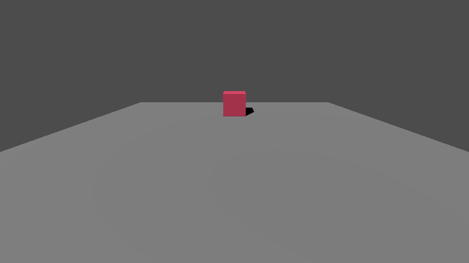

{/* Copyright Francesco Di Blasi 2026 - All Rights Reserved */}

You’ll build a small 3D scene and a player camera, then start a solo session. Each code checkpoint gives you something to verify before you move on. Use a Godot 4.7 project with the Crimson addon installed. [Installation](/installation)

## Create the world and player scenes

### 1. Build the world

1. Start a new scene. In the **Scene** dock, click **3D Scene** to create a `Node3D` root. Rename the root `World`.
2. Select `World` and click **Add Child Node**. Search for [`PlayerSpawnPoint`](/api/classes/PlayerSpawnPoint) and click **Create**. Leave its **Transform → Position** at `(0, 0, 0)`. Crimson uses this position to place the player.
3. Select `World` again and add a `MeshInstance3D` child named `Floor`. In the **Inspector**, open the **Mesh** dropdown and choose **New BoxMesh**. Click the new resource to expand it and set its **Size** to `(12, 0.2, 12)`. Under the node’s **Transform**, set **Position** to `(0, -0.1, 0)` so the floor’s top is level with the spawn point.
4. Add another `MeshInstance3D` directly under `World` and name it `Box`. Give it a **New BoxMesh** and keep the default size. Set the node’s **Position** to `(0, 0.5, -3)` so it sits on the floor in front of the camera. For the color shown in the screenshot, add a **New StandardMaterial3D** under **Geometry → Material Override** and set its **Albedo → Color** to `#C63858`.
5. Add a `DirectionalLight3D` directly under `World`. Set **Transform → Rotation** to `(-45°, -30°, 0°)` and turn on **Shadow → Enabled**. Press **Ctrl+S** and save the scene as `res://world.tscn`.

### 2. Build the player

1. Create another scene with a **3D Scene** root named `Player`.
2. Add a `Camera3D` child. In **Transform**, set **Position** to `(0, 2, 5)` and **Rotation** to `(-20°, 0°, 0°)`. The camera sits above and behind the spawn point, angled toward the box.
3. Save the scene as `res://player.tscn`. Keep one camera in the player scene so Crimson can select it for you.

## Start the session

### 3. Create Main and check that its script runs

1. In a new scene, choose **Other Node**. Search for `Node`, click **Create**, and rename the root `Main`. Save the scene as `res://main.tscn`.
2. Right-click `Main` in the **Scene** dock and select **Attach Script**. In the dialog, select **GDScript**, choose the **Object: Empty** template, and set **Path** to `res://main.gd`. Click **Create**. Godot opens the script for you.
3. Replace the contents of `main.gd` with this first checkpoint. Godot calls `_ready()` once `Main` and its children are in the scene tree.

```gdscript
extends Node

func _ready() -> void:
    print("Main is ready.")
```

Save with **Ctrl+S**. With `main.tscn` as the current scene, press **F6**. The game view is empty at this point. Look for `Main is ready.` in the editor’s **Output** panel, then click **Stop** in the editor toolbar.

### 4. Give Crimson the scenes to load

Click the script icon beside `Main` in the **Scene** dock to return to `main.gd`. Replace the file with this checkpoint. The constants name your world and load both scene resources. [`configure()`](/api/classes/GameRuntime/methods/configure) gives you a definition to fill in. [`boot(self)`](/api/classes/GameDefinition/methods/boot) adds the configured game runtime under `Main`.

```gdscript
extends Node

const WORLD_ID: StringName = &"training_room"
const WORLD_SCENE: PackedScene = preload("res://world.tscn")
const PLAYER_SCENE: PackedScene = preload("res://player.tscn")

var game: GameRuntime

func _ready() -> void:
    var definition: GameDefinition = GameRuntime.configure()
    definition = definition.with_starting_world(WORLD_ID, WORLD_SCENE)
    definition = definition.with_player(PLAYER_SCENE)
    game = definition.boot(self)
    if game == null:
        push_error("Could not attach GameRuntime.")
        return

    print("Game runtime attached.")
```

Save and press **F6** again. When **Output** says `Game runtime attached.`, `Main` has a configured runtime. The view stays empty until you start the session. Stop the game before editing the script again.

### 5. Start solo play

Keep the configuration you just tested and replace the checkpoint’s `print()` with the solo operation. [`play_solo()`](/api/classes/GameRuntime/methods/play_solo) starts loading the world and returns a [`GameOperation`](/api/classes/GameOperation). [`await operation.wait()`](/api/classes/GameOperation/methods/wait) resumes when Crimson has finished loading and spawning the player, or reports a failure. Here is the complete `main.gd` at this checkpoint.

```gdscript
extends Node

const WORLD_ID: StringName = &"training_room"
const WORLD_SCENE: PackedScene = preload("res://world.tscn")
const PLAYER_SCENE: PackedScene = preload("res://player.tscn")

var game: GameRuntime

func _ready() -> void:
    var definition: GameDefinition = GameRuntime.configure()
    definition = definition.with_starting_world(WORLD_ID, WORLD_SCENE)
    definition = definition.with_player(PLAYER_SCENE)
    game = definition.boot(self)
    if game == null:
        push_error("Could not attach GameRuntime.")
        return

    var operation: GameOperation = game.play_solo()
    var result: Dictionary = await operation.wait()
    if not result.ok:
        push_error("Could not start solo play: %s" % result.message)
        return

    var player: Node3D = game.get_local_player()
    print("Solo ready: ", player.name)
```

## Run the scene

Save and press **F6** with `main.tscn` selected. The box and floor should appear through the spawned player’s camera. **Output** should show a line beginning with `Solo ready:`. The player stays at the spawn point because this scene has no movement controls.



If the view stays empty, read **Output** first. Check that both scene paths match the constants, the world has a `PlayerSpawnPoint`, and the player scene contains its camera. If Godot cannot find `GameRuntime`, check that the addon loaded. [Verify the installation](/installation#verify-the-installation)

## Configure the same game in the Inspector

Once you have the solo session working, you can move the scene assignments into the Inspector. Stop the game, open `main.tscn`, and add a [`GameRuntime`](/api/classes/GameRuntime) child named `Game` to `Main`. Select `Game` and choose **New GameDefinition** from the **[Definition](/api/classes/GameRuntime/properties/definition)** dropdown. Click the new resource to edit it.

- Set **[Starting World](/api/classes/GameDefinition/properties/starting_world)** to `training_room`.
- Drag `res://world.tscn` from **FileSystem** onto **[Starting World Scene](/api/classes/GameDefinition/properties/starting_world_scene)**.
- Drag `res://player.tscn` onto **[Player Scene](/api/classes/GameDefinition/properties/player_scene)**.

Open the existing `main.gd` attached to `Main` and replace its contents with this version. The runtime is already a child of `Main`, so the script gets it through `$Game` and starts the same solo operation.

```gdscript
extends Node

@onready var game: GameRuntime = $Game

func _ready() -> void:
    var operation: GameOperation = game.play_solo()
    var result: Dictionary = await operation.wait()
    if not result.ok:
        push_error("Could not start solo play: %s" % result.message)
        return

    var player: Node3D = game.get_local_player()
    print("Solo ready: ", player.name)
```

Save and press **F6** to check that you see the same view and `Solo ready:` message.

You can use these scenes to host a game and join it from a second instance on the same computer. [Start a multiplayer game](/multiplayer-quickstart)
